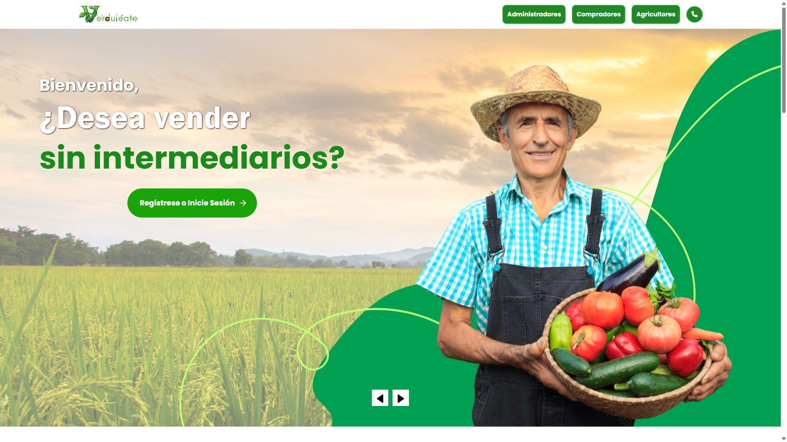

# Verduleate 🥬

[](#)

A digital agricultural marketplace connecting Ecuadorian smallholder farmers directly with local consumers, eliminating intermediaries to ensure fair trade and fresh produce access.



<div align="center">
  
  
  
  
  
  
  
</div>

---

## Key Capabilities

### 👨‍🌾 For Farmers & Growers (`sistema-agricultor`)
- **Producer Onboarding:** Guided registration and farm profile configuration.
- **Harvest & Inventory Management:** Add, edit, and catalog farm yields with pricing per pound/quintal, stock levels, and crop photos.
- **Geolocation:** Plot farmlands on geographic maps to optimize local distribution and buyer proximity.
- **Sales Analytics:** Manage incoming orders, fulfillment dispatches, and payout balances.

### 🛒 For Consumers & Buyers (`sistema-comprador`)
- **Interactive Farm Map:** Interactive Leaflet map explorer to discover nearby farms and local harvest points.
- **Freshness Catalog:** Smart filtering across greens, root vegetables, fruits, legumes, and organic goods.
- **Cart & Secure Checkout:** Seamless shopping cart with integrated Stripe payments.
- **Order Tracking:** Real-time visibility into order status from field harvest to doorstep delivery.

### 🛡️ For Administrators (`sistema-admin`)
- **Central Dashboard:** Monitor transaction volume, active agricultural sellers, and customer fulfillment.
- **Customer Support:** Real-time messaging and inquiry channel between buyers and platform admins.

---

## Project Structure

```
VERDULEATE/
├── src/
│   ├── app/
│   │   ├── landingpage/         # Public discovery portal and showcase
│   │   ├── sistema-agricultor/  # Farm administration portal for producers
│   │   ├── sistema-comprador/   # Cart, farm maps, and order tracking for buyers
│   │   ├── sistema-admin/       # Platform oversight and user management
│   │   └── services/            # Firebase Auth, Firestore, and Stripe payment services
│   ├── assets/                  # Icons, vector graphics, and previews
│   │   └── preview.png          # Marketplace landing screenshot preview
│   └── environments/            # Firebase credentials and environment config
└── angular.json                 # Angular CLI build configuration
```

---

## Getting Started

### Prerequisites
- Node.js 18+
- Angular CLI (`npm install -g @angular/cli`)

### Installation
```bash
# Clone the repository
git clone https://github.com/adriangbustos/Verduleate.git
cd Verduleate

# Install dependencies
npm install

# Start development server
ng serve
```
Open `http://localhost:4200` in your web browser.

---

## License

This project is licensed under the MIT License - see the [LICENSE](LICENSE) file for details.
